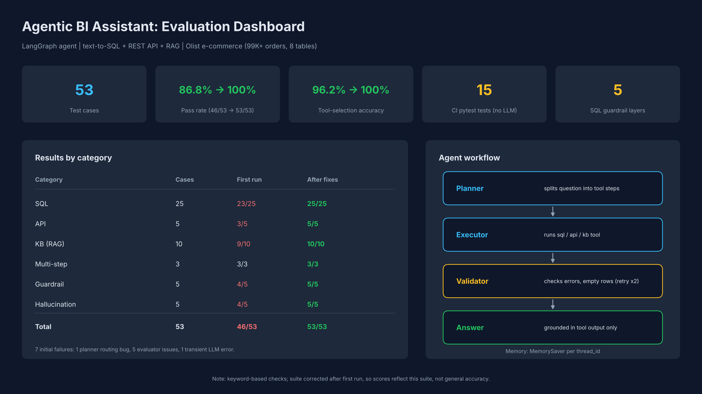
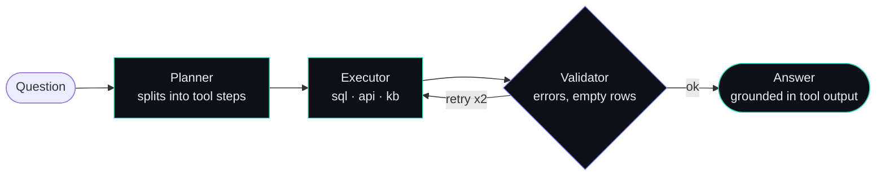
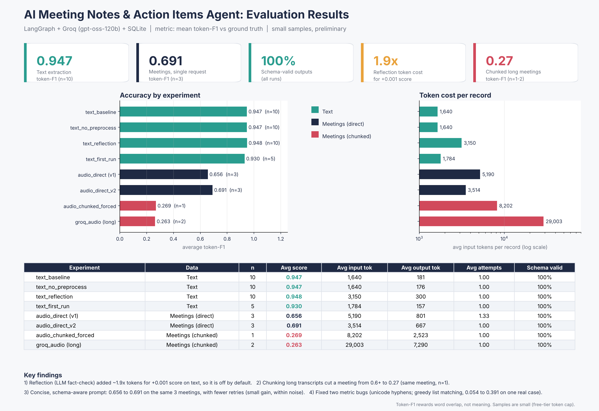
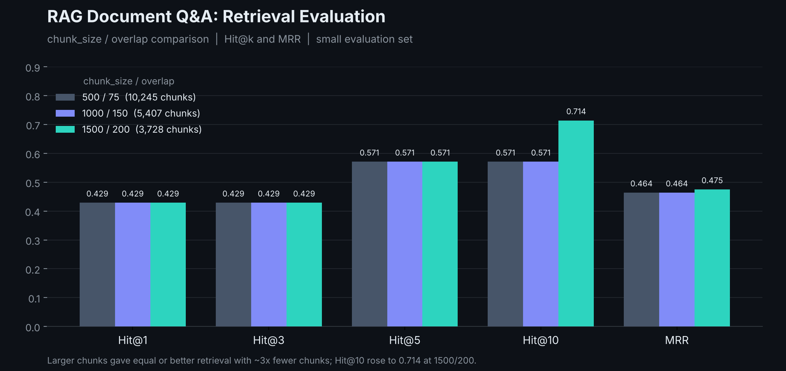
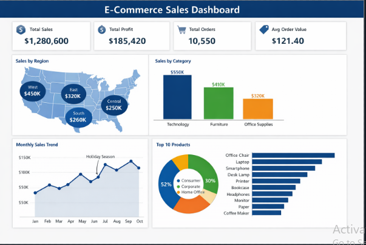

<!-- ============================================================
  GITHUB PROFILE README - Neha Reddy
  Put this README.md in a PUBLIC repo named exactly: nehareddy-web
  Also upload the 4 image files (png) directly into the root of that repo, no folder.
  Search "EDIT" for the few things to check before publishing.
  Palette: slate #0D1117 · text #E6EDF3 · teal #2DD4BF · indigo #818CF8
============================================================= -->

<div align="center">


<br/>


</div>

---

## About

I build **AI systems and the evidence that they work**. Every project below ships with an evaluation: pass rates, retrieval metrics or F1 scores, plus a note on what the numbers do *not* prove.

```python
neha = {
    "role":      "AI/ML Engineer & Data Analyst",
    "builds":    ["LangGraph agents", "RAG pipelines", "text-to-SQL", "BI dashboards"],
    "habit":     "evaluate first, claim later",
    "education": "MCA, Vikrama Simhapuri University",
}
```

---

## Featured AI Projects

### 1 · Agentic AI Business Analytics Assistant
*Ask business questions in plain English. A LangGraph agent routes to SQL, a REST API or a knowledge base, validates the result and answers only from tool output.*

<div align="center">
<a href="https://github.com/nehareddy-web/nehareddy-web/blob/main/agentic-bi-dashboard.png">

</a>
</div>
**[View repository →](https://github.com/nehareddy-web/REPO-NAME)**
<!-- EDIT: replace REPO-NAME with your agentic BI repo name -->




-0D1117?style=flat-square&labelColor=0D1117&color=2DD4BF)

- Runs on the **Olist e-commerce dataset** (99K+ orders, 8 tables) with conversation memory per thread.
- SQL guardrails block destructive and multi-statement queries before they reach the database.
- 7 first-run failures (1 planner routing bug, 5 evaluator issues, 1 transient LLM error) were fixed to reach 53/53.
- *Honest note: keyword-based checks, and the suite was corrected after the first run, so the scores describe this suite, not general accuracy.*

`LangGraph` `Text-to-SQL` `RAG` `REST API` `SQLite` `pytest`

---

### 2 · AI Meeting Notes & Action Items Agent
*Turns meeting transcripts and audio into structured, schema-valid action items.*

<div align="center">
<a href="https://github.com/nehareddy-web/nehareddy-web/blob/main/meeting-agent-results.png">

</a>
</div>
**[View repository →](https://github.com/nehareddy-web/REPO-NAME)**
<!-- EDIT: replace REPO-NAME with your meeting agent repo name -->


- **Reflection (LLM fact-check) cost ~1.9x tokens for a +0.001 gain**, so it is off by default.
- A concise, schema-aware prompt lifted meeting F1 from 0.656 to 0.691 with fewer retries.
- Found and fixed two metric bugs (unicode hyphens, greedy list matching) that were hiding real performance.
- Chunking long transcripts hurt accuracy (0.27 F1 on a small sample), which is a documented next problem to solve.
- *Honest note: small samples, preliminary; token-F1 rewards word overlap, not meaning.*

`LangGraph` `Groq (gpt-oss-120b)` `SQLite` `Pydantic schemas`

---

### 3 · RAG-Based Domain Document Q&A System with Evaluation
*A retrieval pipeline built around measurement: chunk size and overlap are chosen by Hit@k and MRR, not by guessing.*

<div align="center">
<a href="https://github.com/nehareddy-web/nehareddy-web/blob/main/rag-eval.png">

</a>
</div>

| chunk_size / overlap | Chunks | Hit@1 | Hit@5 | Hit@10 | MRR |
|:--|--:|:-:|:-:|:-:|:-:|
| 500 / 75 | 10,245 | 0.429 | 0.571 | 0.571 | 0.464 |
| 1000 / 150 | 5,407 | 0.429 | 0.571 | 0.571 | 0.464 |
| **1500 / 200** | **3,728** | 0.429 | 0.571 | **0.714** | **0.475** |

Larger chunks matched or beat smaller ones with **~3x fewer chunks**, so the 1500 / 200 setup is the better trade-off here. *Small evaluation set, so treat it as a direction, not a verdict.*

**[View repository →](https://github.com/nehareddy-web/RAG-Based-Domain-Document-Q-A-System-with-Evaluation)**

`Python` `RAG` `Retrieval evaluation` `Hit@k` `MRR`

---

## Analytics & BI Work

<table>
<tr>
<td width="50%" valign="top">

#### E-commerce Sales Dashboard
<a href="https://github.com/nehareddy-web/nehareddy-web/blob/main/ecommerce-dashboard.png">

</a>

Automated dashboard on **10,200+ sales records**: revenue **+15% YoY**, margin **+3.2 pp**, reporting time **-35%**, and drill-through that led to **7%** less overstock.

`Power BI` `Excel` `SQL`

</td>
<td width="50%" valign="top">

#### Customer Churn Prediction
Analysed **7,500+ telecom records** to find the top churn drivers. Built a classifier with **84% accuracy** and **0.89 ROC-AUC**, shared as a **Streamlit app** for business users.

`Python` `SQL` `Scikit-learn` `XGBoost` `Streamlit`

</td>
</tr>
</table>
<!-- EDIT: the dashboard image shows 10,550 orders but the text says 10,200+ records. Make them match. -->

---

## Impact at Work

| Area | What I built | Result |
|:--|:--|:--|
| **Hiring analytics** | SQL bottleneck analysis | Time-to-hire **-18%** |
| **Prediction** | XGBoost candidate-conversion model | Accuracy **71% → 87%** |
| **Resume screening** | TF-IDF + cosine-similarity pipeline | **~40%** less manual effort (~150 hrs saved) |
| **Data prep** | Python ETL pipeline | **4 hrs → 45 min** per batch |
| **Reporting** | Automated Power BI dashboards | Reporting effort **-35%** |
| **Inventory** | Drill-through profitability analysis | Overstock **-7%** |

<div align="center">

**150K+** records analysed &nbsp;·&nbsp; **5,200+** resumes processed &nbsp;·&nbsp; **10,200+** sales records examined

</div>

---

## Experience

<details open>
<summary><b>Data Analyst · Methodhub</b> &nbsp;|&nbsp; <i>Jul 2026 – Present</i> &nbsp;|&nbsp; Quantum Hiring: Predictive Hiring Analytics</summary>
<br/>

- Analysed **150K+** recruitment records with SQL (CTEs, window functions) and Python, identified **3 bottleneck stages** and cut time-to-hire by **18%**.
- Automated Power BI dashboards for time-to-hire, offer-acceptance and cost-per-hire, saving leadership **~10 hrs/week**.
- Built Apache Superset dashboards adopted by **4 business units**.
- Developed an XGBoost model for candidate-to-hire conversion, lifting accuracy from **71% to 87%** (ROC-AUC **+0.12**).

</details>

<details>
<summary><b>Data Analyst Intern · Rubix AI Solutions</b> &nbsp;|&nbsp; <i>Dec 2025 – Jun 2026</i> &nbsp;|&nbsp; Automated Resume Screening System</summary>
<br/>

- Built a Python ETL pipeline for **5,200+** resumes, cutting data prep from **4 hrs to 45 min** per batch.
- Identified the top 10 skill clusters, improving job-description match relevance by **22%**.
- Built a TF-IDF and cosine-similarity ranking pipeline, cutting manual screening by **~40%** (about **150 hours** over 6 months).
- Created automated Power BI and Excel reports, shortening HR reporting turnaround by **25%**.

</details>

---

## Tech Stack

<table>
<tr>
<td width="140"><b>AI / ML</b></td>
<td>


</td>
</tr>
<tr>
<td><b>Languages & Data</b></td>
<td>


</td>
</tr>
<tr>
<td><b>BI & Apps</b></td>
<td>


</td>
</tr>
<tr>
<td><b>Practices</b></td>
<td>


</td>
</tr>
</table>

---

## Education & Certifications

| Degree | Institution | Years | CGPA |
|:--|:--|:-:|:-:|
| **MCA** (Master of Computer Applications) | Vikrama Simhapuri University | 2024 – 2026 | **8.7 / 10** |
| **BCA** (Bachelor of Computer Applications) | Vikrama Simhapuri University | 2021 – 2024 | **9.0 / 10** |

- Data Science & AI Certification, **Datamites**
- Generative AI & Machine Learning Training, **DeepLearning.AI** (Jan 2025)

---

## Currently Focused On

- Making agent evaluations larger and more rigorous (bigger samples, semantic metrics beyond token-F1)
- Improving **RAG** retrieval quality and **text-to-SQL** reliability
- End-to-end dashboards (Operations, Healthcare), with Power BI connected directly to SQL

---

## Let's Connect

<div align="center">

[](https://www.linkedin.com/in/YOUR-HANDLE)
[](mailto:YOUR-EMAIL)
<!-- EDIT: add your LinkedIn handle and email, or delete this block -->


</div>
